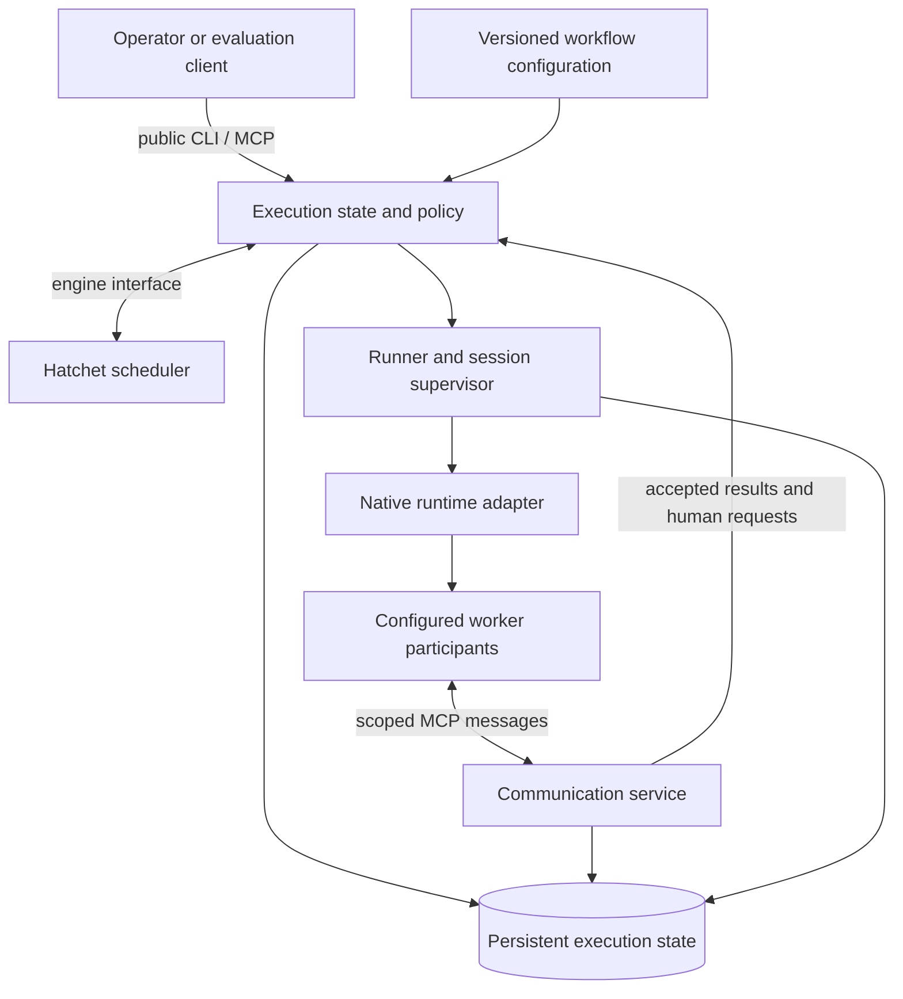
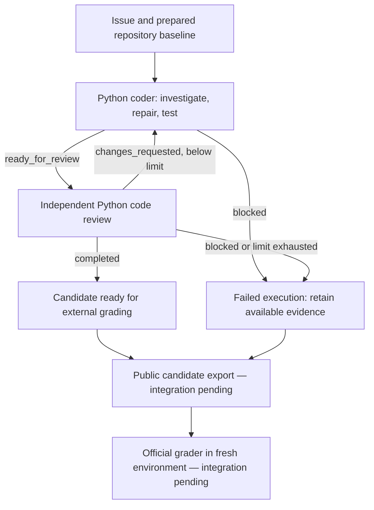

# Pragma: A Control Plane and Configured Workflow for Agentic Software Engineering

Empirical systems manuscript — internal draft, 8 November 2026.

**Authoring note:** `[[...]]` marks evidence or analysis to insert after the benchmark studies. This manuscript is not for publication until those fields are resolved. See the separate [publication checklist](whitepaper-checklist.md); the authoring note is removed from the submission version.

## Abstract

Pragma runs configurable software-development workflows and records their execution. We describe its control plane and autonomous Python benchmark variants with bounded author/reviewer loops. We compare a single coding agent with a sequential author/reviewer workflow on SWE-bench Lite, and test control-plane reliability separately. The evaluation combines fault tests with official grading on [[BENCHMARK_RELEASES_AND_COHORTS]], covering [[UNIQUE_TASK_COUNT]] tasks and [[TRIAL_COUNT]] trials without human intervention under [[TOTAL_BUDGET_POLICY]]. Against [[BASELINE]], [[PRIMARY_CORRECTNESS_RESULT_WITH_UNCERTAINTY]]. Resource and reliability results are [[RESOURCE_AND_RELIABILITY_RESULTS_WITH_UNCERTAINTY]]. These findings [[SUPPORTED_INTERPRETATION]], subject to [[PRINCIPAL_EMPIRICAL_LIMITATIONS]].

## 1. Introduction

A coding agent's results depend on more than its model. Instructions, repository context, tools, review rules and human intervention all affect the work. When these change between sessions without being recorded, results are difficult to reproduce or improve.

We make these choices explicit, version them, and compare their effects on defined tasks. The central research question is:

> Does an author/reviewer workflow resolve more SWE-bench Lite issues than a single coding agent under the same total budget?

Execution contracts define who may act, how work is accepted as complete, and how delivery and recovery work. Collaboration policies define assignments, information flow, review loops and human involvement. The control plane enforces these rules; benchmarks measure the resulting work.

The baseline is a single coding agent. The treatment adds explicit author/reviewer roles and bounded revision loops. Both use the same control plane. This comparison tests the workflow, not the causal benefit of the control plane itself.

Pragma combines established practices: declarative workflows, independent review, bounded iteration and executable checks. It introduces no new orchestration algorithm. We describe both the control plane and the Python repair workflow because both affect the results.

The paper makes three contributions:

1. A control-plane architecture that separates execution authority, worker communication and native agent execution through explicit contracts.
2. A versioned participant workflow specifying author/reviewer responsibilities, evidence handoffs, bounded iteration and human authority.
3. An empirical evaluation of [[EVALUATED_COMPARISONS]], reporting independent product outcomes, resource consumption, coordination failures and uncertainty.

## 2. Background and Related Work

### 2.1 Workflows, agents and orchestration

Anthropic distinguishes predefined workflows from model-directed execution and describes routing, parallelization and evaluator–optimizer patterns. These provide a vocabulary for the workflow studied here. ([Anthropic, 2024](https://www.anthropic.com/research/building-effective-agents))

Cemri et al. classify multi-agent failures in system design, agent coordination and task verification. Their analysis suggests examining coordination and termination failures alongside individual model errors. ([Cemri et al., 2025, v3](https://arxiv.org/abs/2503.13657v3))

**Implication:** compare sequential and concurrent review by quality, time and total effort.

### 2.2 Direct prior art: Anemoi and thread-based collaboration

Anemoi is direct prior art. Its planner initiates work; specialized agents refine the plan through MCP threads, with critique and answer-finding agents supporting submission. Its discovery, membership, messaging and notification tools overlap with Pragma’s communication design. ([Ren et al., 2025, §§3.1–3.3](https://arxiv.org/html/2508.17068v3#S3))

| Dimension | Anemoi as described | Pragma's present configuration |
| --- | --- | --- |
| Execution authority | Planner-led initiation and agent negotiation of the evolving plan | Declared routes, loop rules and human gates enforced by the controller |
| Worker communication | Direct discussion through MCP threads | Execution-scoped MCP threads; the Python repair workflow currently uses sequential handoffs |
| Criticism | Dedicated critique participant in the discussion | Explicit architecture and code reviewer assignments |
| Terminal boundary | Participant consultation/consensus followed by answer submission | Accepted typed invocation result, then configured routing |
| Evaluation domain | General-assistant tasks on GAIA | Repository-level software engineering; exact evaluated cohorts are specified in Section 6 |

Anemoi reports **52.73% pass@3** on GAIA validation against **43.64%** for its reproduced OWL baseline in Table 3, approximately **9.09 percentage points** higher. The abstract lists the baseline as 43.63%; this paper uses the table value. That comparison concerns general-assistant tasks, not repository-repair performance or single-attempt accuracy. Shared worker models/tools strengthen the comparison, but the treatment changes several coordination features together; it does not isolate the effect of the communication server. ([Ren et al., Table 3 and §4](https://arxiv.org/html/2508.17068v3#S4))

Pragma lets agents reason and exchange evidence while the controller decides when work is complete and which step runs next. Anemoi’s communication-delay failures motivate separate measures for busy workers, message delivery and missing results. Messaging alone does not solve context selection or history management. ([Ren et al., §5 and Appendix B](https://arxiv.org/html/2508.17068v3#S5))

### 2.3 Feedback, repair and review

Olausson et al. find that self-repair gains on HumanEval/APPS vary by model and task and are often modest after accounting for cost. Feedback quality is a limiting factor. We therefore compare specific repair evidence with generic retry instructions. ([Olausson et al., ICLR 2024](https://arxiv.org/abs/2306.09896v5))

Reflexion retains feedback across attempts without updating model weights. It provides a precedent for preserving feedback; our finding ledger does not implement Reflexion. ([Shinn et al., NeurIPS 2023](https://arxiv.org/abs/2303.11366v4))

Google’s review guidance emphasizes technical reasoning and code health without demanding perfection. We use this principle to separate defects from preferences and allow reviewers to withdraw incorrect findings. ([Google, The Standard of Code Review](https://google.github.io/eng-practices/review/reviewer/standard.html))

**Implication:** a review should identify a checkable defect, a response and a verified resolution. More iterations alone do not show progress.

### 2.4 Context selection and retained state

Liu et al. show that retrieval accuracy depends on where information appears in a long context. Their experiments do not test our model, but caution against assuming that more history always helps. ([Liu et al., TACL 2024](https://aclanthology.org/2024.tacl-1.9/))

Anthropic recommends targeted retrieval and compact retained context. We test explicit handoffs and source-linked notes rather than continually expanding conversation history. ([Anthropic, 2025](https://www.anthropic.com/research/effective-context-engineering-for-ai-agents))

**Implication:** record and test context policy, and keep summaries linked to their sources.

### 2.5 Evaluation and developer productivity

SWE-bench tests issue resolution in existing repositories. Lite selects a smaller set of its Python tasks for more affordable evaluation. ([Jimenez et al., ICLR 2024](https://arxiv.org/abs/2310.06770))

Agent-evaluation guidance separates interaction traces from outcomes, and executable grading from model or human judgment. We likewise distinguish accepted completion from product correctness. ([Anthropic, 2026](https://www.anthropic.com/research/demystifying-evals-for-ai-agents))

In an early-2025 randomized trial, METR's experienced open-source participants took longer with the studied AI tools despite expecting a speedup. This is evidence about a bounded developer population and tool generation, not a universal claim about AI-assisted development. ([Becker et al., 2025](https://arxiv.org/abs/2507.09089); [study methodology](https://metr.org/blog/2025-07-10-early-2025-ai-experienced-os-dev-study/)) METR's February 2026 follow-up reported selection and time-measurement problems that made newer estimates unreliable, including difficulties involving concurrent agent use. ([METR, 2026](https://metr.org/blog/2026-02-24-uplift-update/))

This selective review informs our design and comparisons. The study tests execution contracts and collaboration policies together; it does not claim novelty for messaging or multi-agent review.

## 3. Research Questions

We study the control plane and the participant workflow. Fault tests check the control plane’s contracts; software benchmarks assess the product built by the complete system, including its models, tools and environment.

| Question | Comparison | Evidence |
| --- | --- | --- |
| RQ1: Does author/reviewer coordination improve issue resolution? | Single coding agent versus sequential author/reviewer workflow, with matched total budgets and human policy | Official per-instance grades and paired differences |
| RQ2: What does review cost? | The same variants and tasks | Tokens, known cost, elapsed time, aggregate agent duration and human effort, interpreted alongside correctness |
| RQ3: Does the control plane honor its contracts under faults? | Deterministic fixtures for duplicate messages, invalid completion, interruption and bounded recovery | Invariant violations and recovery outcomes, reported separately from benchmark scores |

Measure reliability and product correctness separately. Lower token use is useful only in relation to product quality. Fewer reported findings do not establish convergence, and faster completion must not conceal skipped checks or extra human work.

The study targets SWE-bench Lite’s full 300-task Python test split. The autonomous packages are [[EVALUATED_LANGUAGES_AND_PACKAGE_VARIANTS]]. Conclusions are limited to repository issue resolution, not general-assistant performance or developer productivity.

## 4. Part I — The Factory Control Plane

The diagram separates scheduling, process execution and conversation. Workers
perform assignments; the controller applies declared routes. Neither a peer
message nor a model's free-form reply replaces an accepted terminal result.

### 4.1 Execution model and policy ownership

A **scenario** specifies the requested behavior, source baseline, acceptance criteria and evaluation conditions. A **factory variant** specifies the workflow and its package, model, tool and policy choices. An **execution** is one run of that variant with captured input. A **stage** groups work and policy; a **step visit** is an entry into one configured step; an **attempt** is a supervised invocation within that visit.

A review **round** is one pass through the steps in a loop. Human feedback can start another bounded series of rounds, so the loop limit does not cap the total number of visits.

The configuration defines assignments, allowed outcomes, required evidence, human decisions, retry rules and limits. Controller-enforced checks are distinct from instructions an agent is asked to follow.

### 4.2 Component boundaries

| Component | Responsibility | Interface |
| --- | --- | --- |
| Factory definition | Process policy, package selection and outcome routing | Validated, pinned YAML configuration |
| Worker package | Role, tools, skills and native defaults | Entrypoint, runtime requirements and supported overrides |
| Control plane | Execution state, accepted results, human requests, supervision and evidence | Public operations and execution-scoped MCP |
| Workflow engine | Durable scheduling, routing and waits | Engine interface |
| Runtime adapter | Native version/configuration, events and delivery | Adapter interface |
| Lifecycle utility | Optional source-workspace and commit operations | Command/arguments and versioned hook input |
| Evaluation client | Submission and evidence collection | Public control-plane CLI/MCP only |

The evaluator uses the public interface rather than launching or repairing workers itself. These boundaries do not sandbox the host runtime.

### 4.3 Execution lifecycle, scheduling and recovery

The CLI/MCP client submits a configuration and captured input to a shared service. The control plane pins the execution definition, establishes invocation identities and records steps, visits, attempts, sessions, decisions and events. A Go engine interface separates the control plane from the current Hatchet scheduler; Factory-owned PostgreSQL records retain control-plane state alongside the engine's own tables. The CLI is a client, not the workflow executor. ([Control-plane overview](../../../controls/README.md); [engine integration](../../../controls/docs/hatchet-engine.md))

The scheduler follows configured routes, loops and human checkpoints. Sequential loops run members in order. Concurrent loops start all members, share a communication thread and require compatible exit routes. A round ends when every member has an accepted result. The reference Go workflow is sequential. ([Loop semantics](../../../controls/docs/factory-yaml.md#loop-execution-mode))

Persistent state does not imply process recovery: the local service cannot reattach interrupted agent sessions after restart. Operators must inspect the execution before retrying. Review-loop limits also do not govern infrastructure retries. ([Service lifecycle](../../../controls/README.md); [configuration and retry limits](../../../controls/docs/factory-yaml.md))

### 4.4 Communication, completion and human interaction

Workers communicate through execution-scoped, authenticated MCP. The server exposes thread creation/membership, message send/read/wait and thread closure through eight tools. Its envelope reuses A2A 0.3 content parts; this is not an implementation of the complete A2A task protocol. Thread messages, memberships, receipts and typed effects are persisted. Notifications wake readers; they do not constitute delivery, acknowledgment or completion. ([Communication contract](../../../controls/docs/communications.md))

| Interaction | Implemented meaning | What it does not establish |
| --- | --- | --- |
| Ordinary message / progress | Addressed or broadcast conversation within an authorized thread | A workflow transition or product correctness |
| Publication | Retained file revision and content digests | Acceptance of the published design or implementation |
| `step_result` | Typed terminal outcome accepted for the assigned invocation | Completion of a peer, successful grading or waiver of human approval |
| `input_request` / `input_response` | Correlated human input with authorization and option validation | An agent's authority to approve its own work |
| `runtime_status` | Adapter observation of busy/idle state, addressed only to the controller | Semantic completion or an independent security signal |

An agent finishes an invocation by sending a valid `step_result` and receiving an accepted-effect receipt. The server checks assignment identity, thread, allowed outcome, pending input, publication and applicable output requirements before accepting it. Result, message and idempotency receipt are committed together. An uncertain transport response can be retried with identical content and the same operation ID; a corrected invalid payload requires a new operation ID. These mechanisms address duplicate effects and invalid handoffs, not the truth of an agent's claims. ([Completion and receipts](../../../controls/docs/communications.md#completion-call))

The runtime bridge delivers incoming messages through the native session interface. In Pi, messages are queued or steered through RPC and acknowledged after successful handoff. That acknowledgment does not prove the model read, understood or acted on the message. `wait_for_message` supports bounded long polling but does not itself inject a model turn, launch a participant or wake a stopped process. ([Delivery ownership](../../../controls/docs/communications.md#pi-and-other-runners))

The controller responds to rejected completion payloads with a recorded correction message containing allowed outcomes and an example. It can also remind an idle worker that has not submitted a result. Pending human input pauses recovery. The default allows two reminders before fencing and failing the invocation; this limit is separate from review rounds. ([Bounded recovery](../../../controls/docs/communications.md#errors-and-bounded-recovery))

A human gate controls workflow progression; an input request asks for information during an assignment. Both are recorded. Neither counts as independent benchmark grading.

### 4.5 Agent-runtime boundary and execution files

A package supplies a role, entrypoint, instructions, skills, tools and native defaults. An explicitly selected adapter handles native compatibility and preparation; a host supervisor owns the process, output, cancellation and session record. The engine depends on a runner interface rather than Pi's profile formats or event names. Pi is the current native integration in this workflow; architectural replaceability is not evidence of equivalent behavior across untested runners. ([Adapter interface and ownership](../../../controls/docs/runtime-adapters.md))

Execution documents use the pinned execution-files directory, separate from the source workspace selected by a package's launcher. The collector checks file containment and actual bytes and retains published review revisions. Source-worktree utilities remain optional hooks; the control plane does not need Git to execute a workflow. Neither directory permissions, scoped MCP credentials nor a Git worktree provide a host-process sandbox. Isolated benchmark environments and remote artifact transport require additional runtime capabilities. ([Execution-file contract](../../../controls/docs/execution-files.md); [hook contract](../../../controls/docs/hooks.md))

### 4.6 Recorded evidence and outcome classes

Maintain separate records for:

- **Process outcome:** submission, progress, technical failures and terminal route.
- **Product verification:** checks against required behavior, including failures and missing coverage.
- **Assessment:** model/human judgments, findings and decisions with their provenance.
- **Resource observations:** time, reported token categories, known costs, tool activity and human effort.

A planned check, an agent's claim, a retained tool result and an independent reviewer execution are different evidence classes. Reused evidence must still apply to the submitted revision. A published artifact's digest identifies bytes, not their correctness.

## 5. Part II — The Python Issue-Repair Workflow

The [Python factory](../python_swe_bench_lite/README.md) targets existing-repository
bug fixes. It uses the supplied issue and source baseline directly, without requiring
separate specification or plan documents. Its two configurations define the study
variants; the older human-reviewed Go workflow is not the benchmark treatment.

The single-agent baseline performs implementation and self-review in one invocation.
The treatment uses a separate reviewer and allows at most two coder/reviewer rounds.
Both are autonomous: no admission override, human approval or discretionary rescue.
The controller routes accepted outcomes; there is no additional planning model.

### 5.1 Participants and evidence

| Participant | Owns | Handoff |
| --- | --- | --- |
| Python coder | Source changes, local regression tests and implementation evidence | Returns a candidate for review, or a concrete blocker |
| Python reviewer | Independent inspection, focused checks and findings; does not edit source | Accepts review readiness or requests specific repairs |
| Official evaluator | Independent application of the candidate patch and benchmark grading | Produces per-instance results after the agent attempt; integration pending |

Both agents link to the shared Python repair skill, which follows each repository’s
interpreter, dependency and test conventions. The reviewer also uses critical-review
guidance. Neither assumes that all projects use pytest or permits upgrading dependencies
to hide a failing check. Worker instructions prohibit reference-solution lookup, but
runtime isolation is required to enforce that boundary.

The coder records commands, results and limitations in `reviews/implementation.md`;
the reviewer records findings in `reviews/code.md`. These live in execution storage,
separate from source changes. Findings keep stable IDs across rounds. The coder
responds with repairs or counterevidence; the reviewer checks the changed code.
A clean review means no material defect was found in that review, not an official pass.

### 5.2 Configured choices

| Setting | Baseline | Author/reviewer treatment |
| --- | --- | --- |
| Configuration | `baseline.yaml` | `factory.yaml` |
| Participants | Python coder | Same coder plus Python reviewer |
| Iteration | One invocation with self-review | Sequential, at most two rounds |
| Human involvement | None | None |
| Native runtime | Pi 1.0.3 | Pi 1.0.3 |
| Model defaults | OpenRouter / DeepSeek V4 Flash; medium thinking | Same for both roles |
| Starter per-attempt limits | 200,000 reported tokens; 2,400 seconds | 50,000 tokens; 600 seconds per member |
| Source setup | Preprovisioned instance workspace | Same requirement |

The starter limits give the same nominal maximum of 200,000 tokens and 2,400 agent
seconds without retries. They allocate resources differently: the pair may finish
early and cannot transfer unused step allowances. Token enforcement depends on
reported usage and may overshoot by one response. These are development defaults,
not measured optimal settings or a guarantee of equal cost. Freeze the actual study
budgets and allocation after development trials; report them in Section 6.

Review-limit exhaustion fails the execution. It does not imply reviewer acceptance,
and it must not silently discard a candidate from grading. The pending output contract
must preserve candidates and evidence from failed or budget-exhausted executions when
available. Local workflow state and official correctness remain separate measurements.

### 5.3 Configuration and integration status

The [factory and baseline](../python_swe_bench_lite/README.md) and Python worker bundles
are implemented. The current host runner does not provide benchmark isolation,
instance provisioning, public patch export or official grading. Those integrations
are recorded in [Registry](../../bench_issues.md), [Controls](../../../controls/bench_issues.md)
and [Bench](../../../bench/bench_issues.md). No benchmark score is implied by loading
a configuration or passing its contract tests.

Record the actual configuration digest, package/skill revisions, adapter, model,
source baseline, environment and budgets for every trial. A stable model name does
not guarantee a hosted provider remains unchanged.

## 6. Experimental Setup and Method

We compare the following aspects of the system. An end-to-end result alone cannot identify which component caused an improvement.

| Evaluation level | Keep fixed | Vary or exercise | Supported conclusion |
| --- | --- | --- | --- |
| Control-plane conformance and reliability | Small deterministic worker fixtures and explicit workflow contracts | Message duplication/rejection, delivery, cancellation, process interruption, restart and bounded recovery | Whether a particular build honors its infrastructure contracts under the tested faults |
| Workflow comparison | Control-plane build, runtime/environment, benchmark cohort and declared budgets | Participant roles, instructions, tools, sequential/concurrent topology, review or admission policy | Effect of the declared workflow treatment under those conditions |
| Runtime/adapter comparison | Control-plane policy and equivalent assignments | Native runner/adapter and its capabilities | Integration-specific behavior; equivalence must be demonstrated, not assumed |
| End-to-end benchmark | Fully identified system variant and official benchmark protocol | Repeated held-out task instances or predeclared system treatments | Product results and resource distributions for the complete system |

Fault tests check infrastructure behavior; coding benchmarks check software outcomes. Neither substitutes for the other.

### 6.1 SWE-bench Lite

The first study uses **SWE-bench Lite**, which tests issue resolution in existing repositories. Its introducing release contains 300 tasks from Python repositories. Each task supplies an issue and a repository baseline. The official grader applies the candidate patch and checks both issue-specific fixes and existing behavior. ([Benchmark description](https://www.swebench.com/lite.html); [official evaluation guide](https://www.swebench.com/SWE-bench/guides/evaluation/))

Lite is a selected subset of the original SWE-bench, distinct from Verified and Multilingual. We do not pool their scores. GAIA, Terminal-Bench and longer-horizon benchmarks remain related work, not evaluation targets for this paper. The broader [benchmark literature survey](benchmark-survey.md) is retained as background.

| Study | Dataset revision / split | Languages | Unique tasks | Selection / exclusions | Development tasks excluded |
| --- | --- | --- | ---: | --- | --- |
| [[STUDY_ID]] | [[REVISION_SPLIT]] | [[LANGUAGES]] | [[N_TASKS]] | [[COHORT_RULE_AND_EXCLUSIONS]] | [[DEVELOPMENT_INSTANCE_IDS]] |

The target cohort is the full 300-task test split at a pinned revision, with no Go-only filter. Freeze the test manifest and use Lite’s separate 23-task dev split or deterministic fixtures for integration and tuning. If test tasks are exposed during development, disclose that exposure rather than describing them as held out. Missing or failed trials remain in the inventory; they do not silently shrink the cohort.

Pin the dataset commit, evaluator revision, source baselines, environment images and attempt budgets. Keep reference patches, test patches and grader feedback outside the agent phase. Use the official grader in a fresh environment and retain its per-instance results. ([Dataset](https://huggingface.co/datasets/SWE-bench/SWE-bench_Lite); [evaluation harness](https://github.com/SWE-bench/SWE-bench))

Both study variants are autonomous: no human approvals, repair hints or discretionary retries. Unexpected requests for human help follow a declared terminal policy. Any intervention is a protocol deviation, reported separately. Unexpected human requests are recorded as blockers, not auto-approved.

### 6.2 Variants and procedure

Each trial runs one system variant on one benchmark instance. A variant includes the control-plane build, workflow, packages, adapters, models, tools and environment. Workflow comparisons hold the control plane fixed; changing both cannot isolate either effect.

| Variant ID | Control-plane / adapter revisions | Workflow configuration digest | Participants / topology | Models and settings | Total budget and allocation | Human policy |
| --- | --- | --- | --- | --- | --- | --- |
| [[BASELINE_ID]] | [[REVISIONS]] | [[CONFIG_DIGEST]] | [[BASELINE_COORDINATION]] | [[MODELS_SETTINGS]] | [[BUDGET_ALLOCATION]] | [[HUMAN_POLICY]] |
| [[TREATMENT_ID]] | [[REVISIONS]] | [[CONFIG_DIGEST]] | [[TREATMENT_COORDINATION]] | [[MODELS_SETTINGS]] | [[BUDGET_ALLOCATION]] | [[HUMAN_POLICY]] |

The primary comparison is a single coding agent versus the sequential author/reviewer workflow. Match task access, tool capabilities, applicable model settings, total budgets and human policy. Record instructions, role allocation and other unavoidable differences. Concurrent review, admission classifiers and context-policy ablations are deferred. [[ACTUAL_CONTROLS_AND_UNAVOIDABLE_DIFFERENCES]]

Both variants run through the same control plane and official grader. The autonomous author/reviewer variant must define its behavior on unresolved findings and review-limit exhaustion; neither means the product passed. Anemoi remains architectural prior art; this is not an Anemoi reproduction or a GAIA comparison. [[COORDINATION_COMPARATOR_IMPLEMENTATION_AND_SCOPE]]

| Study | Comparison / fault condition | Repetitions per instance or fixture | Ordering / seed | Primary endpoint | Analysis population |
| --- | --- | ---: | --- | --- | --- |
| [[STUDY_ID]] | [[CONTRAST_OR_FAULT]] | [[REPETITIONS]] | [[ORDERING_SEED]] | [[PRIMARY_ENDPOINT]] | [[DENOMINATOR_POLICY]] |

Freeze cohort selection, treatments, resource limits, stopping rules and the analysis plan before test outcomes are inspected. Tune policies on separate development tasks. Pair comparisons by instance and interleave or randomize execution order to reduce temporal/provider effects. Repetition counts and precision goals are [[SAMPLE_SIZE_RATIONALE]]; uncertainty estimation is [[INTERVAL_OR_TEST_METHOD_AND_CLUSTERING]]. Repeated attempts are not independent new benchmark tasks.

Control-plane fault tests use deterministic worker fixtures and specify injected faults, expected invariants and recovery bounds. Benchmark runs use the declared participant workflows and official graders. [[FAULT_FIXTURE_REVISION_AND_INJECTION_PROCEDURE]] Record exceptions to the registered procedure, with dates and reasons, in [[PROTOCOL_DEVIATIONS_ARTIFACT]].

### 6.3 Measures

| Property | Measure | Limits |
| --- | --- | --- |
| Process reliability | Accepted submissions reaching each terminal outcome; technical failure/intervention counts | Include rejected, cancelled, ambiguous and unreported trials in the inventory |
| Coordination reliability | Completion rejections/corrections, duplicate-effect incidents, unresolved requests, delivery failures and recovery exhaustion | Use recorded evidence or controlled fixtures; an acknowledgment is not proof of comprehension; unavailable observations remain unavailable |
| Product correctness | Independent, criterion-specific verification on the submitted revision | Agent agreement or human approval alone is not an independent product pass |
| Repair convergence | Material findings resolved, reopened or still open; rounds and attempts | Finding volume is not quality; consistent adjudication is required |
| Elapsed time | Submission-to-terminal span and stage spans | Includes operator and recovery waiting |
| Agent effort | Sum of supervised attempt durations | Concurrent durations overlap; not equivalent to wall time or provider compute |
| Human effort | Recorded active review/repair time and interventions | Waiting at a human gate is not a measure of active human labor |
| Resource use | Reported input, output, cache-read and cache-write tokens; known monetary cost | Unknown telemetry/prices remain unknown; cached tokens have different accounting implications |
| Verification strength | Criteria exercised, actual checks, limitations and revision linkage | Coverage percentages and command counts are insufficient on their own |

Report process completion and independently verified success separately. Retain missing outcomes and telemetry in the trial inventory. Unknown prices are not zero cost. Include failed runs in resource summaries; label summaries restricted to successful runs.

Report distributions, sample counts and uncertainty accounting for paired tasks and repeated runs. Define treatment of human decisions, infrastructure failures, cancellations and budget exhaustion before analysis. Avoid composite quality scores with no clear interpretation.

### 6.4 Grading and adjudication

Use executable checks where possible, retaining grader version, tested revision, results and limitations. For human or model judgments, specify the rubric and calibration sample. An agent’s self-review is not independent grading.

Distinguish incorrect findings, accepted risk and unmet requirements. Record technical rescue separately from routine approval. Blind judges to treatment labels where practical; disclose when blinding or grader isolation fails.

### 6.5 Public-interface evaluation boundary

The evaluation client must use supported Factory CLI/MCP operations only, following the [public-interface boundary](../../../controls/docs/agent-operator.md). The harness does not inspect worker directories, invoke setup/hooks, open databases/runtime storage, access product workspaces, or copy/test source directly. Factory owns worker execution. This is a system-under-test boundary, not a restriction on the workers' authorized development checks.

The collector retains public execution, report and stream responses. Candidate output must be exported through an explicit supported contract and graded in the benchmark's prescribed clean environment, with private test/reference material excluded from the agent phase. The evaluated integration, versions and isolation checks are [[PUBLIC_EXPORT_GRADING_CONTRACT_AND_VALIDATION]]. Missing grading or compromised isolation makes a trial ineligible for an independently graded result; retain that outcome in the trial inventory rather than bypassing the interface.

### 6.6 Reproducibility materials

| Material | Required identity / contents | Study artifact |
| --- | --- | --- |
| Cohort | Release, revision, split, exact instance IDs and exclusions | [[COHORT_MANIFEST]] |
| System | Control-plane/adapter versions, factory configuration and package/skill identities | [[SYSTEM_MANIFEST]] |
| Environment | Source baselines, image digests, architecture, resource limits and network rules | [[ENVIRONMENT_MANIFEST]] |
| Execution evidence | Trial inventory, inputs, decisions, messages, trajectories and available usage | [[EXECUTION_ARCHIVE]] |
| Grading | Candidate-output identities, official harness version, per-instance results and failures | [[GRADING_ARCHIVE]] |
| Analysis | Aggregation code, registered analysis, figure/table inputs and deviations | [[ANALYSIS_ARCHIVE]] |

Archive the study materials under stable identifiers, respecting licenses and documenting redactions. The [Bench repository](../../../bench/README.md) holds the local experiment setup.

## 7. Results

### 7.1 Trial accounting

| Study / variant | Planned trials | Submitted | Terminal executions | Officially graded | Infra failures | Cancelled / budget-exhausted | Missing / invalid | Protocol deviations |
| --- | --- | --- | --- | --- | --- | --- | --- | --- |
| [[STUDY_VARIANT]] | [[N]] | [[N]] | [[N]] | [[N]] | [[N]] | [[N_BY_CATEGORY]] | [[N_BY_CATEGORY]] | [[N_AND_REFERENCES]] |

[[TRIAL_ACCOUNTING_ANALYSIS]] Reconcile all trials, including rejected and ambiguous submissions. Explain overlapping categories, missing grades and telemetry gaps.

### 7.2 Independently graded benchmark outcomes

| Benchmark / cohort | Variant | Unique tasks / repetitions | Resolved / declared denominator | Metric and attempt policy | Estimate / uncertainty | Paired difference from baseline / uncertainty |
| --- | --- | --- | --- | --- | --- | --- |
| [[BENCHMARK_COHORT]] | [[VARIANT]] | [[TASKS_REPETITIONS]] | [[RESOLVED_DENOMINATOR]] | [[METRIC_ATTEMPTS]] | [[ESTIMATE_INTERVAL]] | [[DIFFERENCE_INTERVAL]] |

**Figure 1:** [[PER_TASK_PAIRED_OUTCOMES_AND_AGGREGATE_INTERVAL_PLOT]]

[[PRODUCT_OUTCOME_ANALYSIS]] Identify the metric, attempt policy, denominator and uncertainty method. Distinguish subsets from full-benchmark results and contextual comparisons from matched ones.

### 7.3 Resource consumption and time

| Study / variant | Trials with complete usage / total | Input / output / cache tokens | Total cost / coverage | Elapsed time median / spread | Aggregate agent duration | Active human effort / coverage |
| --- | --- | --- | --- | --- | --- | --- |
| [[STUDY_VARIANT]] | [[N_TOTAL]] | [[CATEGORY_DISTRIBUTIONS]] | [[COST_COVERAGE]] | [[TIME_DISTRIBUTION]] | [[AGENT_DURATION]] | [[HUMAN_EFFORT_COVERAGE]] |

**Figure 2:** [[CORRECTNESS_RESOURCE_FRONTIER_AND_PAIRED_TIME_TOKEN_DISTRIBUTIONS]]

[[RESOURCE_ANALYSIS]] Include failed and timed-out work. Report cache accounting and missing prices; interpret resource use alongside correctness.

### 7.4 Execution-contract reliability and coordination failures

| Contract / injected fault | Fixture and repetitions | Observed invariant violations | Recovery success / eligible cases | Recovery time / messages | Unrecovered cases and evidence |
| --- | --- | --- | --- | --- | --- |
| [[CONTRACT_FAULT]] | [[FIXTURE_REPETITIONS]] | [[VIOLATIONS]] | [[RECOVERED_DENOMINATOR]] | [[RECOVERY_DISTRIBUTIONS]] | [[FAILURE_REFERENCES]] |

**Figure 3:** [[COORDINATION_FAILURE_BREAKDOWN_AND_RECOVERY_DISTRIBUTION]]

[[CONTRACT_RELIABILITY_ANALYSIS]] Separate injected faults from benchmark failures. Support failure classifications with traces. Zero observed violations does not establish fault freedom.

### 7.5 Ablations and sensitivity

| Research question / contrast | Held-fixed factors | Task/repository groups | Effect / uncertainty | Additional resource or human cost | Supporting artifact |
| --- | --- | --- | --- | --- | --- |
| [[RQ_CONTRAST]] | [[CONTROLS]] | [[STRATA]] | [[EFFECT_INTERVAL]] | [[RESOURCE_EFFECT]] | [[ARTIFACT]] |

[[ABLATION_AND_SENSITIVITY_ANALYSIS]] Separate planned tests from exploratory analyses. Report subgroup and budget effects with uncertainty. Defer any research question not tested.

## 8. Discussion

### 8.1 Answers to the research questions

| Research question | Empirical answer | Supporting results | Scope / alternative explanation |
| --- | --- | --- | --- |
| [[TESTED_RQ]] | [[SUPPORTED_ANSWER]] | [[TABLE_FIGURE_ARTIFACT]] | [[LIMITS_CONFOUNDERS]] |

[[CENTRAL_HYPOTHESIS_ASSESSMENT]] Explain whether the results support, contradict or leave the hypothesis unresolved. Distinguish workflow improvements, control-plane reliability and product correctness.

### 8.2 Interpretation relative to prior work

[[INTERPRETATION_RELATIVE_TO_ANEMOI_AND_OTHER_STUDIES]] Discuss coordination, review effort, tools, environments and models as possible explanations. Keep architectural comparisons separate from comparable benchmark results.

### 8.3 Engineering implications and observed limits

[[EVIDENCE_BASED_ENGINEERING_IMPLICATIONS]] Identify where contracts helped, review justified its cost, or fixed policy hindered progress. Include negative results and explain trace selection.

## 9. Threats to Validity

| Threat | Consequence | Required treatment |
| --- | --- | --- |
| Construct validity | Completion, tokens, coverage or finding counts may be mistaken for engineering quality | Define each claim and its supporting measure; keep assessments separate |
| Internal validity | Changed packages, prompts, toolchains, providers or human interventions confound comparisons | Pin/record available provenance; use controlled variants and matched policies |
| Statistical conclusion validity | Small samples, high variance and selective reporting produce unstable conclusions | Register trials, retain failures, report uncertainty and avoid causal claims from uncontrolled observations |
| External validity | A selected benchmark or language subset does not represent all software engineering | Declare task/language strata and subset identities; retain development data outside research evaluation |
| Evaluator dependence | Reviewers, judges and graders can share assumptions or access expected answers | Disclose information access, assess grader sensitivity and distinguish independence from role separation |
| Missing data | Absent prices, tool evidence or product checks can bias reported efficiency and success | Preserve unknown values and report coverage/availability denominators |
| Environment and isolation | Host permissions, shared caches and provider drift can alter outcomes or contaminate evaluation | Record limitations; do not describe configuration isolation as a sandbox |
| Human measurement | Approval waiting and discretionary rescue distort productivity estimates | Measure active effort separately and classify interventions consistently |

[[STUDY_SPECIFIC_VALIDITY_ANALYSIS]] Describe the threats observed, affected trials and resulting limits on the conclusions.

## 10. Conclusion

Pragma separates execution authority and communication contracts from a configurable participant workflow. The evaluated system combines [[CONTROL_PLANE_AND_WORKFLOW_VARIANTS]] under [[BENCHMARK_SCOPE]]. The principal empirical finding is [[PRIMARY_FINDING_WITH_EFFECT_AND_UNCERTAINTY]]; the corresponding resource/reliability trade-off is [[TRADEOFF]]. These results support [[BOUNDED_CONCLUSION]], while [[UNRESOLVED_QUESTION_OR_LIMITATION]] remains unresolved. [[FOLLOW_UP_JUSTIFIED_BY_RESULTS]]

## 11. References

Sources accessed 8 November 2026.

1. [Anthropic — Building effective agents](https://www.anthropic.com/research/building-effective-agents), 19 December 2024.
2. [Anthropic — Effective context engineering for AI agents](https://www.anthropic.com/research/effective-context-engineering-for-ai-agents), 29 September 2025.
3. [Google Engineering Practices — The Standard of Code Review](https://google.github.io/eng-practices/review/reviewer/standard.html).
4. [Go project — Data Race Detector](https://go.dev/doc/articles/race_detector).
5. [Go project — Getting started with fuzzing](https://go.dev/doc/tutorial/fuzz).
6. [Anthropic — Demystifying evals for AI agents](https://www.anthropic.com/research/demystifying-evals-for-ai-agents), 9 January 2026.
7. Olausson, T. X., Inala, J. P., Wang, C., Gao, J., and Solar-Lezama, A. [*Is Self-Repair a Silver Bullet for Code Generation?*](https://arxiv.org/abs/2306.09896v5), ICLR 2024; arXiv v5, 2 February 2024.
8. Shinn, N., Cassano, F., Berman, E., Gopinath, A., Narasimhan, K., and Yao, S. [*Reflexion: Language Agents with Verbal Reinforcement Learning*](https://arxiv.org/abs/2303.11366v4), NeurIPS 2023.
9. Cemri, M., et al. [*Why Do Multi-Agent LLM Systems Fail?*](https://arxiv.org/abs/2503.13657v3), 2025 preprint; v3, 26 October 2025.
10. Liu, N. F., et al. [*Lost in the Middle: How Language Models Use Long Contexts*](https://aclanthology.org/2024.tacl-1.9/), Transactions of the Association for Computational Linguistics 12 (2024), 157–173. [DOI: 10.1162/tacl_a_00638](https://doi.org/10.1162/tacl_a_00638).
11. Jimenez, C. E., et al. [*SWE-bench: Can Language Models Resolve Real-World GitHub Issues?*](https://arxiv.org/abs/2310.06770), ICLR 2024.
12. Becker, J., Rush, N., Barnes, E., and Rein, D. [*Measuring the Impact of Early-2025 AI on Experienced Open-Source Developer Productivity*](https://arxiv.org/abs/2507.09089), 2025. [METR methodology and discussion](https://metr.org/blog/2025-07-10-early-2025-ai-experienced-os-dev-study/).
13. METR. [*We are Changing our Developer Productivity Experiment Design*](https://metr.org/blog/2026-02-24-uplift-update/), 24 February 2026.
14. Bender, A. [*Testing Overview*](https://abseil.io/resources/swe-book/html/ch11.html), chapter 11 of *Software Engineering at Google*, 2020.
15. Git project. [*git-worktree* reference](https://git-scm.com/docs/git-worktree).
16. Go project. [*context* package overview](https://pkg.go.dev/context#pkg-overview).

17. Ren, X., et al. [*Anemoi: A Semi-Centralized Multi-agent System Based on Agent-to-Agent Communication MCP server from Coral Protocol*](https://arxiv.org/html/2508.17068v3), 2025 preprint; v3, 10 October 2025.

The [benchmark literature survey](benchmark-survey.md) retains the broader publication inventory. Those benchmarks are outside this study. SWE-bench Lite is described in its [introducing project article](https://www.swebench.com/lite.html); its evaluation uses the [official SWE-bench harness](https://github.com/SWE-bench/SWE-bench).

Implementation references: [factory definition](../python_swe_bench_lite/factory.yaml), [agent library](../../agents/README.md), [review method](../../skills/critical-code-review/references/review-method.md), [execution semantics](../../../controls/docs/factory-yaml.md), [communications](../../../controls/docs/communications.md), and [operator interface](../../../controls/docs/agent-operator.md). These repository sources govern actual supported behavior.
