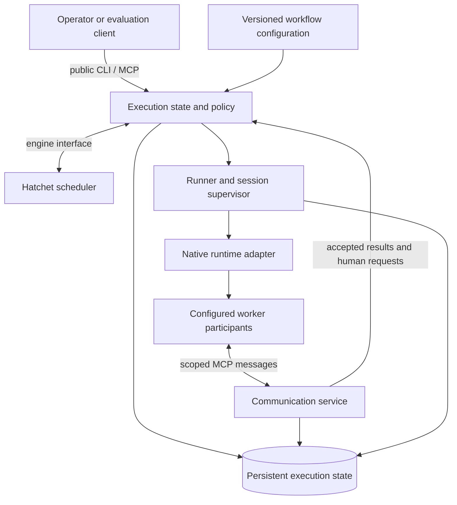
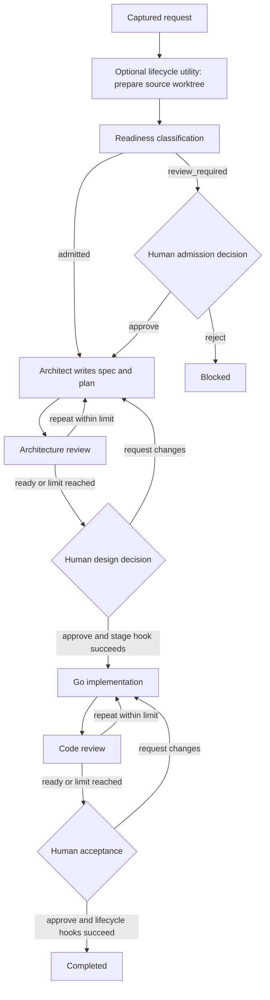
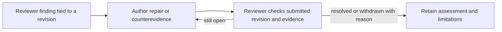

# Pragma: A Control Plane and Configured Workflow for Agentic Software Engineering

Empirical systems manuscript — internal draft, 8 November 2026.

**Authoring note:** `[[...]]` marks evidence or analysis to insert after the benchmark studies. This manuscript is not for publication until those fields are resolved. See the separate [publication checklist](whitepaper-checklist.md); the authoring note is removed from the submission version.

## Abstract

Pragma runs configurable software-development workflows and records their execution. We describe its control plane and a workflow with author/reviewer pairs, bounded review loops and human approvals. We test whether explicit execution rules and collaboration policies improve reliability and resource efficiency. The evaluation combines fault tests with independently graded benchmarks: [[BENCHMARK_RELEASES_AND_COHORTS]], covering [[UNIQUE_TASK_COUNT]] tasks and [[TRIAL_COUNT]] trials under [[BUDGET_AND_HUMAN_POLICY]]. Against [[BASELINE]], [[PRIMARY_CORRECTNESS_RESULT_WITH_UNCERTAINTY]]. Resource and reliability results are [[RESOURCE_AND_RELIABILITY_RESULTS_WITH_UNCERTAINTY]]. These findings [[SUPPORTED_INTERPRETATION]], subject to [[PRINCIPAL_EMPIRICAL_LIMITATIONS]].

## 1. Introduction

A coding agent's results depend on more than its model. Instructions, repository context, tools, review rules and human intervention all affect the work. When these change between sessions without being recorded, results are difficult to reproduce or improve.

We make these choices explicit, version them, and compare their effects on defined tasks. The central research question is:

> Can explicit execution contracts and configurable collaboration policies make multi-agent software engineering more reliable and resource-efficient than less constrained coordination?

Execution contracts define who may act, how work is accepted as complete, and how delivery and recovery work. Collaboration policies define assignments, information flow, review loops and human involvement. The control plane enforces these rules; benchmarks measure the resulting work.

The comparison needs a concrete baseline, such as a model-directed planner with peer discussion. Such a planner may adapt to unfamiliar problems better than a fixed workflow. We therefore compare outcomes under declared budgets and human-intervention rules.

Pragma combines established practices: declarative workflows, independent review, bounded iteration and executable checks. It introduces no new orchestration algorithm. We describe both the control plane and the Go workflow because both affect the results.

The paper makes three contributions:

1. A control-plane architecture that separates execution authority, worker communication and native agent execution through explicit contracts.
2. A versioned participant workflow specifying author/reviewer responsibilities, evidence handoffs, bounded iteration and human authority.
3. An empirical evaluation of [[EVALUATED_COMPARISONS]], reporting independent product outcomes, resource consumption, coordination failures and uncertainty.

## 2. Background and Related Work

### 2.1 Workflows, agents and orchestration

Anthropic distinguishes predefined workflows from model-directed execution and describes routing, parallelization and evaluator–optimizer patterns. These provide a vocabulary for the workflow studied here. ([Anthropic, 2024](https://www.anthropic.com/research/building-effective-agents))

Cemri et al. classify multi-agent failures in system design, agent coordination and task verification. Their analysis suggests examining coordination and termination failures alongside individual model errors. ([Cemri et al., 2025, v3](https://arxiv.org/abs/2503.13657v3))

**Implication:** compare sequential and concurrent review by quality, time and total effort.

### 2.2 Direct prior art: Anemoi and thread-based collaboration

Anemoi is direct prior art. Its planner initiates work; specialized agents refine the plan through MCP threads, with critique and answer-finding agents supporting submission. Its discovery, membership, messaging and notification tools overlap with Pragma’s communication design. ([Ren et al., 2025, §§3.1–3.3](https://arxiv.org/html/2508.17068v3#S3))

| Dimension | Anemoi as described | Pragma's present configuration |
| --- | --- | --- |
| Execution authority | Planner-led initiation and agent negotiation of the evolving plan | Declared routes, loop rules and human gates enforced by the controller |
| Worker communication | Direct discussion through MCP threads | Execution-scoped MCP threads; the Go workflow currently uses sequential handoffs |
| Criticism | Dedicated critique participant in the discussion | Explicit architecture and code reviewer assignments |
| Terminal boundary | Participant consultation/consensus followed by answer submission | Accepted typed invocation result, then configured routing |
| Evaluation domain | General-assistant tasks on GAIA | Repository-level software engineering; exact evaluated cohorts are specified in Section 6 |

Anemoi reports **52.73% pass@3** on GAIA validation against **43.64%** for its reproduced OWL baseline in Table 3, approximately **9.09 percentage points** higher. The abstract lists the baseline as 43.63%; this paper uses the table value. That comparison concerns general-assistant tasks, not repository-repair performance or single-attempt accuracy. Shared worker models/tools strengthen the comparison, but the treatment changes several coordination features together; it does not isolate the effect of the communication server. ([Ren et al., Table 3 and §4](https://arxiv.org/html/2508.17068v3#S4))

Pragma lets agents reason and exchange evidence while the controller decides when work is complete and which step runs next. Anemoi’s communication-delay failures motivate separate measures for busy workers, message delivery and missing results. Messaging alone does not solve context selection or history management. ([Ren et al., §5 and Appendix B](https://arxiv.org/html/2508.17068v3#S5))

### 2.3 Feedback, repair and review

Olausson et al. find that self-repair gains on HumanEval/APPS vary by model and task and are often modest after accounting for cost. Feedback quality is a limiting factor. We therefore compare specific repair evidence with generic retry instructions. ([Olausson et al., ICLR 2024](https://arxiv.org/abs/2306.09896v5))

Reflexion retains feedback across attempts without updating model weights. It provides a precedent for preserving feedback; our finding ledger does not implement Reflexion. ([Shinn et al., NeurIPS 2023](https://arxiv.org/abs/2303.11366v4))

Google’s review guidance emphasizes technical reasoning and code health without demanding perfection. We use this principle to separate defects from preferences and allow reviewers to withdraw incorrect findings. ([Google, The Standard of Code Review](https://google.github.io/eng-practices/review/reviewer/standard.html))

**Implication:** a review should identify a checkable defect, a response and a verified resolution. More iterations alone do not show progress.

### 2.4 Context selection and retained state

Liu et al. show that retrieval accuracy depends on where information appears in a long context. Their experiments do not test our model, but caution against assuming that more history always helps. ([Liu et al., TACL 2024](https://aclanthology.org/2024.tacl-1.9/))

Anthropic recommends targeted retrieval and compact retained context. We test explicit handoffs and source-linked notes rather than continually expanding conversation history. ([Anthropic, 2025](https://www.anthropic.com/research/effective-context-engineering-for-ai-agents))

**Implication:** record and test context policy, and keep summaries linked to their sources.

### 2.5 Evaluation and developer productivity

SWE-bench tests issue resolution in existing repositories. Its original Python tasks provide a precedent for repository-level evaluation, not a baseline for the Go factory. ([Jimenez et al., ICLR 2024](https://arxiv.org/abs/2310.06770))

Agent-evaluation guidance separates interaction traces from outcomes, and executable grading from model or human judgment. We likewise distinguish accepted completion from product correctness. ([Anthropic, 2026](https://www.anthropic.com/research/demystifying-evals-for-ai-agents))

In an early-2025 randomized trial, METR's experienced open-source participants took longer with the studied AI tools despite expecting a speedup. This is evidence about a bounded developer population and tool generation, not a universal claim about AI-assisted development. ([Becker et al., 2025](https://arxiv.org/abs/2507.09089); [study methodology](https://metr.org/blog/2025-07-10-early-2025-ai-experienced-os-dev-study/)) METR's February 2026 follow-up reported selection and time-measurement problems that made newer estimates unreliable, including difficulties involving concurrent agent use. ([METR, 2026](https://metr.org/blog/2026-02-24-uplift-update/))

This selective review informs our design and comparisons. The study tests execution contracts and collaboration policies together; it does not claim novelty for messaging or multi-agent review.

## 3. Research Questions

We study the control plane and the participant workflow. Fault tests check the control plane’s contracts; software benchmarks assess the product built by the complete system, including its models, tools and environment.

| Question | Intervention or comparison | Required evidence |
| --- | --- | --- |
| RQ1: Does the control plane preserve its execution and communication contracts under faults? | Fixed workflow with controlled message replay, malformed completion, process interruption and recovery cases | Accepted-result identity, durable receipts, duplicate-effect checks, routing, visible failure state and recovery bounds |
| RQ2: Does evidence-driven repair improve convergence? | Explicit finding/response/verification contract versus current narrative handoff | Verified product outcome, unresolved/reopened findings, review iterations, tokens and human interventions |
| RQ3: Can overlapping design and review reduce elapsed time without reducing quality? | Sequential versus concurrent design under matched budgets and requirements | Consistent final document revisions, product checks, elapsed time, aggregate agent effort and coordination failures |
| RQ4: Does targeted context reduce resource use without losing necessary information? | Targeted retrieval and compact handoffs versus the existing context policy | Acceptance outcome, missed requirements, retrieval failures and token categories |
| RQ5: Is admission useful? | Current classifier threshold versus advisory or alternative policy | Human-labeled actionability, false blocks, overrides and downstream missing-context failures |

Measure reliability and product correctness separately. Lower token use is useful only in relation to product quality. Fewer reported findings do not establish convergence, and faster completion must not conceal skipped checks or extra human work.

The Go factory is the reference implementation, not a language restriction. Other languages and task types require suitable worker configurations. This study evaluates [[EVALUATED_LANGUAGES_AND_PACKAGE_VARIANTS]]. It does not measure organization-wide productivity or production security.

## 4. Part I — The Factory Control Plane

The diagram separates scheduling, process execution and conversation. Workers
perform assignments; the controller applies declared routes. Neither a peer
message nor a model's free-form reply replaces an accepted terminal result.

### 4.1 Execution model and policy ownership

A **scenario** specifies the requested behavior, source baseline, acceptance criteria and evaluation conditions. A **factory variant** specifies the workflow and its package, model, tool and policy choices. An **execution** is one run of that variant with captured input. A **stage** groups work and policy; a **step visit** is an entry into one configured step; an **attempt** is a supervised invocation within that visit.

A review **round** is one pass through the steps in a loop. Human feedback can start another bounded series of rounds, so the loop limit does not cap the total number of visits.

The configuration defines assignments, allowed outcomes, required evidence, human decisions, retry rules and limits. Controller-enforced checks are distinct from instructions an agent is asked to follow.

### 4.2 Component boundaries

| Component | Responsibility | Interface |
| --- | --- | --- |
| Factory definition | Process policy, package selection and outcome routing | Validated, pinned YAML configuration |
| Worker package | Role, tools, skills and native defaults | Entrypoint, runtime requirements and supported overrides |
| Control plane | Execution state, accepted results, human requests, supervision and evidence | Public operations and execution-scoped MCP |
| Workflow engine | Durable scheduling, routing and waits | Engine interface |
| Runtime adapter | Native version/configuration, events and delivery | Adapter interface |
| Lifecycle utility | Optional source-workspace and commit operations | Command/arguments and versioned hook input |
| Evaluation client | Submission and evidence collection | Public control-plane CLI/MCP only |

The evaluator uses the public interface rather than launching or repairing workers itself. These boundaries do not sandbox the host runtime.

### 4.3 Execution lifecycle, scheduling and recovery

The CLI/MCP client submits a configuration and captured input to a shared service. The control plane pins the execution definition, establishes invocation identities and records steps, visits, attempts, sessions, decisions and events. A Go engine interface separates the control plane from the current Hatchet scheduler; Factory-owned PostgreSQL records retain control-plane state alongside the engine's own tables. The CLI is a client, not the workflow executor. ([Control-plane overview](../../../controls/README.md); [engine integration](../../../controls/docs/hatchet-engine.md))

The scheduler follows configured routes, loops and human checkpoints. Sequential loops run members in order. Concurrent loops start all members, share a communication thread and require compatible exit routes. A round ends when every member has an accepted result. The reference Go workflow is sequential. ([Loop semantics](../../../controls/docs/factory-yaml.md#loop-execution-mode))

Persistent state does not imply process recovery: the local service cannot reattach interrupted agent sessions after restart. Operators must inspect the execution before retrying. Review-loop limits also do not govern infrastructure retries. ([Service lifecycle](../../../controls/README.md); [configuration and retry limits](../../../controls/docs/factory-yaml.md))

### 4.4 Communication, completion and human interaction

Workers communicate through execution-scoped, authenticated MCP. The server exposes thread creation/membership, message send/read/wait and thread closure through eight tools. Its envelope reuses A2A 0.3 content parts; this is not an implementation of the complete A2A task protocol. Thread messages, memberships, receipts and typed effects are persisted. Notifications wake readers; they do not constitute delivery, acknowledgment or completion. ([Communication contract](../../../controls/docs/communications.md))

| Interaction | Implemented meaning | What it does not establish |
| --- | --- | --- |
| Ordinary message / progress | Addressed or broadcast conversation within an authorized thread | A workflow transition or product correctness |
| Publication | Retained file revision and content digests | Acceptance of the published design or implementation |
| `step_result` | Typed terminal outcome accepted for the assigned invocation | Completion of a peer, successful grading or waiver of human approval |
| `input_request` / `input_response` | Correlated human input with authorization and option validation | An agent's authority to approve its own work |
| `runtime_status` | Adapter observation of busy/idle state, addressed only to the controller | Semantic completion or an independent security signal |

An agent finishes an invocation by sending a valid `step_result` and receiving an accepted-effect receipt. The server checks assignment identity, thread, allowed outcome, pending input, publication and applicable output requirements before accepting it. Result, message and idempotency receipt are committed together. An uncertain transport response can be retried with identical content and the same operation ID; a corrected invalid payload requires a new operation ID. These mechanisms address duplicate effects and invalid handoffs, not the truth of an agent's claims. ([Completion and receipts](../../../controls/docs/communications.md#completion-call))

The runtime bridge delivers incoming messages through the native session interface. In Pi, messages are queued or steered through RPC and acknowledged after successful handoff. That acknowledgment does not prove the model read, understood or acted on the message. `wait_for_message` supports bounded long polling but does not itself inject a model turn, launch a participant or wake a stopped process. ([Delivery ownership](../../../controls/docs/communications.md#pi-and-other-runners))

The controller responds to rejected completion payloads with a recorded correction message containing allowed outcomes and an example. It can also remind an idle worker that has not submitted a result. Pending human input pauses recovery. The default allows two reminders before fencing and failing the invocation; this limit is separate from review rounds. ([Bounded recovery](../../../controls/docs/communications.md#errors-and-bounded-recovery))

A human gate controls workflow progression; an input request asks for information during an assignment. Both are recorded. Neither counts as independent benchmark grading.

### 4.5 Agent-runtime boundary and execution files

A package supplies a role, entrypoint, instructions, skills, tools and native defaults. An explicitly selected adapter handles native compatibility and preparation; a host supervisor owns the process, output, cancellation and session record. The engine depends on a runner interface rather than Pi's profile formats or event names. Pi is the current native integration in this workflow; architectural replaceability is not evidence of equivalent behavior across untested runners. ([Adapter interface and ownership](../../../controls/docs/runtime-adapters.md))

Execution documents use the pinned execution-files directory, separate from the source workspace selected by a package's launcher. The collector checks file containment and actual bytes and retains published review revisions. Source-worktree utilities remain optional hooks; the control plane does not need Git to execute a workflow. Neither directory permissions, scoped MCP credentials nor a Git worktree provide a host-process sandbox. Isolated benchmark environments and remote artifact transport require additional runtime capabilities. ([Execution-file contract](../../../controls/docs/execution-files.md); [hook contract](../../../controls/docs/hooks.md))

### 4.6 Recorded evidence and outcome classes

Maintain separate records for:

- **Process outcome:** submission, progress, technical failures and terminal route.
- **Product verification:** checks against required behavior, including failures and missing coverage.
- **Assessment:** model/human judgments, findings and decisions with their provenance.
- **Resource observations:** time, reported token categories, known costs, tool activity and human effort.

A planned check, an agent's claim, a retained tool result and an independent reviewer execution are different evidence classes. Reused evidence must still apply to the submitted revision. A published artifact's digest identifies bytes, not their correctness.

## 5. Part II — The Configured Go Development Workflow

The [factory definition](factory.yaml) configures admission, two author/reviewer pairs, human decisions and lifecycle hooks. Section 6 records the variants tested and their differences from this reference workflow.

Failure/rejection routes are abbreviated. A provider error, hook failure or rejected artifact can block progression independently of technical review. Loop-limit escalation can reach a human with unresolved findings; it does not mean the reviewer recommended acceptance.

### 5.1 Participants and handoffs

| Participant | Assignment and owned output | Review / handoff |
| --- | --- | --- |
| Task-readiness classifier | Classify the captured task against the configured actionability policy | Assessment routes to admission or human review; it is not a planning agent |
| Architect | Inspect the task/project; author `spec.html` and `plan.html` | Receives task/readiness context and architecture-review feedback |
| Architecture reviewer | Independently assess the current spec/plan; record stable findings in `reviews/architecture.md` | Requests architect changes or reports readiness for the human design gate |
| Go coder | Implement the approved design in the selected source workspace; report actual checks and limitations | Receives the planning artifacts and code-review feedback |
| Go code reviewer | Inspect the submitted implementation and evidence; independently verify relevant behavior | Requests coding changes or reports readiness for human acceptance |
| Human operator | Resolve admission exceptions, approve/request design changes and accept/request implementation changes | Decisions are recorded control inputs; participation makes a run assisted |

Worker packages supply role instructions, skills, tools and native settings. The factory assigns packages to steps and can override supported model/provider settings. Planning skills define document structure; Go tools support implementation checks; the communication skill defines messaging. Record package and skill revisions alongside the factory configuration. ([Agent library](../../agents/README.md); [workflow and skill configuration](README.md))

In this **sequential** workflow, reviewers return findings before the author runs again. Concurrent review requires a different configuration, with explicit ownership, revision and completion rules.

### 5.2 Configured choices

| Setting | Current configuration | Role in the study |
| --- | --- | --- |
| Admission | Jev `accept` probability at least `0.85`, otherwise human review | An uncalibrated policy to evaluate, not a correctness guarantee |
| Design | Architect plus architecture reviewer; sequential, limit 3 | Candidate baseline for evidence and concurrency experiments |
| Implementation | Go coder plus code reviewer; sequential, limit 3 | Separates authoring from review responsibility |
| Human policy | Design approval and final acceptance; admission override when needed | Must distinguish normal checkpoints from technical recovery |
| Native runtime | Explicit Pi requirement `=1.0.3` | Version compatibility is part of the execution environment |
| Models | OpenRouter / DeepSeek V4 Flash for agents; Jev for admission | Per-role choices, not methodological requirements |
| Model settings | High thinking for architect/reviewers; medium for coder | Experimental parameters; current choices are not proven optimal |
| Lifecycle | Worktree preparation, approved-stage commits, retained checkout | Workspace and provenance utilities through generic hooks |

The classifier receives the captured task and does not inspect source. Human admission approval overrides its assessment rather than rerunning it. The architect receives the original request/response. Preparation currently precedes admission, so rejected requests can still incur workspace setup.

The architect owns `spec.html` and `plan.html`; reviewers own findings; the coder owns source changes. Workflow documents reside in execution evidence storage, separate from the source worktree. Stage hooks commit project changes after human approval; the design hook normally has no source changes to commit. Release retains the worktree rather than merging or pushing.

Git worktrees separate checkout state while sharing repository data. They provide neither a security sandbox nor an independent backup. ([Git, worktree reference](https://git-scm.com/docs/git-worktree)) Proposed mountable execution volumes are separate work and are not implemented in this factory.

### 5.3 Configuration as an experimental record

Record the factory definition, resolved configuration digest, packages, runtimes, source baseline, toolchain, inputs and human-intervention policy. A factory name is insufficient to reproduce a run. Hosted models may still change despite pinned configuration.

See the [factory README](README.md), [configuration reference](../../../controls/docs/factory-yaml.md), [package contract](../../../controls/docs/packages.md), [runtime guide](../../../controls/docs/runtime-adapters.md), and [hook contract](../../../controls/docs/hooks.md) for setup and field definitions.

### 5.4 Evidence-driven review and repair

Each finding states the defect, trigger, evidence, impact and required correction. The author responds under the same finding ID, identifying changes and checks. The reviewer verifies the repair or withdraws an incorrect finding. Human acceptance of remaining risk does not resolve a technical defect.

A design inconsistency may be established through conflicting interfaces or a concrete failure sequence; not every finding requires an executable test. A cancellation defect may require a focused regression check. Go contexts communicate cancellation through a call chain; they do not forcibly terminate arbitrary goroutines. Verification must exercise the affected blocking operation and cleanup. ([Go, context overview](https://pkg.go.dev/context#pkg-overview))

The existing skills already require stable findings and evidence. [GOLANG-001](issues.md) proposes consistent representation and closure across handoffs; it has not introduced a new runtime protocol or an implemented repair ledger.

For Go, select relevant formatting, compile/vet/lint, behavioral, integration, race or fuzz checks. Race detection covers exercised paths, not all possible schedules or unexecuted code. ([Go, Data Race Detector](https://go.dev/doc/articles/race_detector)) Fuzzing explores inputs and can retain failing cases; it requires a meaningful property and a bounded run. ([Go, fuzzing tutorial](https://go.dev/doc/tutorial/fuzz)) Line coverage does not establish that assertions distinguish correct from incorrect behavior. ([Bender, Testing Overview](https://abseil.io/resources/swe-book/html/ch11.html))

## 6. Experimental Setup and Method

We compare the following aspects of the system. An end-to-end result alone cannot identify which component caused an improvement.

| Evaluation level | Keep fixed | Vary or exercise | Supported conclusion |
| --- | --- | --- | --- |
| Control-plane conformance and reliability | Small deterministic worker fixtures and explicit workflow contracts | Message duplication/rejection, delivery, cancellation, process interruption, restart and bounded recovery | Whether a particular build honors its infrastructure contracts under the tested faults |
| Workflow comparison | Control-plane build, runtime/environment, benchmark cohort and declared budgets | Participant roles, instructions, tools, sequential/concurrent topology, review or admission policy | Effect of the declared workflow treatment under those conditions |
| Runtime/adapter comparison | Control-plane policy and equivalent assignments | Native runner/adapter and its capabilities | Integration-specific behavior; equivalence must be demonstrated, not assumed |
| End-to-end benchmark | Fully identified system variant and official benchmark protocol | Repeated held-out task instances or predeclared system treatments | Product results and resource distributions for the complete system |

Fault tests check infrastructure behavior; coding benchmarks check software outcomes. Neither substitutes for the other.

### 6.1 Benchmarks

The table below identifies the tasks used in this study. The broader benchmark inventory is related work, not the study sample.

| Study ID | Benchmark / exact release | Dataset revision and split | Languages | Unique tasks | Selection / exclusions | Research questions |
| --- | --- | --- | --- | ---: | --- | --- |
| [[STUDY_ID]] | [[BENCHMARK_RELEASE]] | [[REVISION_SPLIT]] | [[LANGUAGES]] | [[N_TASKS]] | [[COHORT_RULE_AND_EXCLUSIONS]] | [[RQ_IDS]] |

Retain exact instance IDs, selection date, development/test split, licenses and environment/grader revisions. Label all subsets.

Choose benchmarks for the research question. Repository repair, terminal operation and proposal assessment test different abilities. Adapting the Go factory to another task changes the experimental configuration.

#### Publication-count method

This inventory records publications verified as of **8 November 2026**. We count benchmark introductions with evaluations, original empirical uses, audits and studies of identified derivatives. Citations, copied scores and leaderboard entries alone do not qualify. Versions of one paper count once; project articles are listed separately.

Counts are **lower bounds for the listed publications**, not worldwide adoption estimates. Papers can appear in several rows; do not sum the rows. Introductions, audits and derivative studies are distinguished from independent use. The SWE-bench family row groups publications, not scores.

| Benchmark or release family | What it measures / relevance | Research publications verified here | Origin versus subsequent use |
| --- | --- | ---: | --- |
| **SWE-bench / Lite / Verified family** | Existing-repository issue resolution. Strong initial candidate for external comparison if the factory is configured for the selected language and exact split. | **7**: B01–B07 | 1 introduction; 6 subsequent agent/model studies or technical reports. Original, Lite and Verified scores remain separate. |
| **SWE-bench Verified specifically** | Human-filtered Python issue-resolution tasks; suitable for an autonomous repository-repair baseline. | **3**: B05, B06, B07 | All 3 are subsequent model studies/reports with explicit Verified results. This is a subset of the family inventory, not 3 additional papers. |
| **[SWE-bench Multilingual](https://www.swebench.com/multilingual.html)** | Cross-language repository repair; includes Go but does not require restricting evaluation to it. | **1**: B07; **plus 1 project publication**: N01 | 1 subsequent model technical report; N01 is the introducing project article, not counted as a research paper. |
| **Multi-SWE-bench** | Issue resolution across seven languages, with 1,632 instances in the introducing release. Distinct from SWE-bench Multilingual. | **1**: B08 | Introducing paper with baseline evaluations; additional empirical uptake is not quantified by this inventory. |
| **SWE-bench-Live** | Refreshed issue-resolution tasks; relevant to temporal robustness. Freeze an exact release and language split for repeated studies. | **1**: B09 | Introducing paper with agent/model evaluations; later multilingual project releases are not silently treated as the same evaluated split. |
| **SWE-rebench / V2** | Fresh evaluation cohorts and executable task collection; relevant to contamination and environment preparation. | **2**: B10, B11 | Two originating works: B10 evaluates the original benchmark; B11 studies multilingual dataset/environment construction. This does not establish 2 independent uses of one held-out benchmark. |
| **SWE-Bench Pro, original** | Longer-horizon repository work; candidate for testing planning and review under larger changes. | **3**: B12, B13, B17 | 1 introduction; 2 subsequent studies audit or re-evaluate the original benchmark. Audits are not counted as independent factory comparisons. |
| **SWE-Bench Pro V2** | Revised tasks and evaluation restrictions. Consider separately from original Pro. | **1**: B13 | V2 introduction/re-evaluation; no further independent V2 publication is claimed here. |
| **Terminal-Bench 2.0 / 2.1 research** | Terminal-based tasks with environment-level verification; useful beyond code patching and across languages. | **5**: B07, B14, B15, B16, B18 | 1 introduction; 2 agent/model/optimizer evaluations; 1 maintenance audit introducing 2.1; 1 modified-starting-state study. Subsets and altered starting states must be labeled. |
| **DeepSWE** | Original long-horizon repository tasks; potentially relevant to sustained planning/implementation. Confirm artifact access and exact version before selecting. | **2**: B17, B18 | 1 introduction; 1 derivative starting-state study. Does not establish two comparable evaluations of the unmodified full benchmark. |
| **SWE-Lancer** | Freelance engineering and selection among technical proposals; relevant to broader implementation and decision workflows. | **1**: B19 | Introducing paper with evaluations. Proposal-selection results are distinct from implementation results; payout-based scoring is not measured productivity. |

#### Publication inventory and evidence locations

| ID | Publication | Empirical use verified for the counts above |
| --- | --- | --- |
| B01 | [Jimenez et al., *SWE-bench*, ICLR 2024](https://arxiv.org/abs/2310.06770) | Introduces and evaluates repository issue resolution on original SWE-bench. |
| B02 | [Yang et al., *SWE-agent*, 2024](https://arxiv.org/abs/2405.15793v3) | Reports SWE-bench experiments; abstract and evaluation section. Not assigned to Verified solely from later project leaderboards. |
| B03 | [Xia et al., *Agentless*, 2024](https://arxiv.org/abs/2407.01489v2) | Reports SWE-bench Lite results and analyzes a filtered Lite-S variant. Lite-S is not the original Lite score. |
| B04 | [Wang et al., *OpenHands*, ICLR 2025](https://arxiv.org/abs/2407.16741v3) | Software-engineering evaluation includes SWE-bench; counted at family level, not asserted to use Verified. |
| B05 | [Wei et al., *SWE-RL*, NeurIPS 2025](https://arxiv.org/abs/2502.18449v2) | Explicit SWE-bench Verified model evaluation; abstract and main results. |
| B06 | [Yang et al., *Kimi-Dev*, 2025](https://arxiv.org/abs/2509.23045v3) | Explicit SWE-bench Verified evaluations of workflow and agent settings. |
| B07 | [DeepSeek-AI, *DeepSeek-V3.2*, 2025 technical report](https://arxiv.org/html/2512.02556v1#S4) | Main-results table and Appendix C report SWE Verified, SWE Multilingual and Terminal-Bench 2.0. These are model-author measurements, not independent replication. |
| B08 | [Zan et al., *Multi-SWE-bench*, 2025](https://arxiv.org/abs/2504.02605) | Introduces the benchmark and evaluates Agentless, SWE-agent and OpenHands. Multiple baselines in one paper count as one publication. |
| B09 | [Zhang et al., *SWE-bench Goes Live!*, 2025](https://arxiv.org/abs/2505.23419v2) | Introduces and evaluates SWE-bench-Live; agent/model experiments in the original release. |
| B10 | [Badertdinov et al., *SWE-rebench*, 2025](https://arxiv.org/abs/2505.20411v2) | Introduces fresh task collection and agent evaluation. A dated evaluation cohort is not the entire released training corpus. |
| B11 | [*SWE-rebench V2: Language-Agnostic SWE Task Collection at Scale*, 2026](https://arxiv.org/html/2602.23866v2#S4) | Empirical construction, setup and quality-filter experiments; classified as dataset-construction evidence, not independent adoption of a fixed held-out test set. |
| B12 | [Deng et al., *SWE-Bench Pro*, 2025](https://arxiv.org/abs/2509.16941v2) | Introduces long-horizon tasks and evaluates models under a common scaffold. |
| B13 | [*SWE-Bench Pro V2: A Cleaner, Harder-to-Game Coding Benchmark*, 2026](https://arxiv.org/abs/2610.24206) | Audits/revises original Pro and evaluates a modified task set/protocol. Counted as original-Pro audit and V2 introduction, not interchangeable scores. |
| B14 | [Merrill et al., *Terminal-Bench*, 2026](https://arxiv.org/abs/2601.11868) | Introduces the 89-task Terminal-Bench 2.0 release and evaluates models/agents. |
| B15 | [Wang, Kattakinda and Feizi, *Do Agent Optimizers Compound?*, 2026](https://arxiv.org/abs/2607.14004) | Evaluates optimizer treatments using hard Terminal-Bench 2.0 tasks under matched optimization budgets; subset/continual-learning protocol. |
| B16 | [Buchanan et al., *Benchmarks as Software*, 2026](https://arxiv.org/abs/2611.08417) | Audits Terminal-Bench 2.0, releases repairs as 2.1 and evaluates sensitivity to resource budgets; maintenance study. |
| B17 | [Huang et al., *DeepSWE*, 2026](https://arxiv.org/abs/2607.07946) | Introduces/evaluates DeepSWE and reports an audit of original SWE-Bench Pro verification; distinct types of empirical use. |
| B18 | [Li et al., *SWE-Residual*, 2026](https://arxiv.org/html/2610.25899#S5) | Evaluates clean and inherited-work states derived from DeepSWE and Terminal-Bench; a task-state transformation, not an unchanged leaderboard protocol. |
| B19 | [Miserendino et al., *SWE-Lancer*, 2025](https://arxiv.org/abs/2502.12115v4) | Introduces freelance implementation and managerial proposal-selection evaluations. |
| N01 | [Khandpur et al., SWE-bench Multilingual project article](https://www.swebench.com/multilingual.html) | Introduces the dataset and reports SWE-agent baseline results. Project publication; excluded from research-paper counts. |

The inventory contains **19 research papers/technical reports and one project article**. It is not a systematic review or popularity ranking.

#### Selection and comparability

Report repository repair and terminal tasks separately. A selected language subset does not establish full multilingual performance.

Pin dataset version, instance IDs, environment image, test/verification artifacts, network rules, runtime/model, task and attempt budgets, and intervention policy. Keep hidden tests, reference patches and grader feedback unavailable during the agent phase as the official protocol requires. Do not silently rewrite benchmark inputs into a different task. Follow the benchmark's rules for output extraction and clean-environment grading.

Separate human-assisted and autonomous runs. Declare gates, extra context, repair hints and discretionary retries. To test whether planning and review justify their cost, compare matched budgets; label any unconstrained comparison separately.

Version identity is substantive: Pro V2 changes its evaluation protocol, and the Terminal-Bench maintenance study introduces 2.1 repairs. Original and revised scores cannot be pooled under a generic benchmark label. A benchmark harness or grading backend must integrate through a supported control-plane contract; the eval client still must not reach into worker directories or product workspaces. ([Pro V2 study](https://arxiv.org/abs/2610.24206); [Buchanan et al., 2026](https://arxiv.org/abs/2611.08417))

### 6.2 Variants and procedure

Each trial runs one system variant on one benchmark instance. A variant includes the control-plane build, workflow, packages, adapters, models, tools and environment. Workflow comparisons hold the control plane fixed; changing both cannot isolate either effect.

| Variant ID | Control-plane / adapter revisions | Workflow configuration digest | Participants / topology | Models and settings | Total budget and allocation | Human policy |
| --- | --- | --- | --- | --- | --- | --- |
| [[BASELINE_ID]] | [[REVISIONS]] | [[CONFIG_DIGEST]] | [[BASELINE_COORDINATION]] | [[MODELS_SETTINGS]] | [[BUDGET_ALLOCATION]] | [[HUMAN_POLICY]] |
| [[TREATMENT_ID]] | [[REVISIONS]] | [[CONFIG_DIGEST]] | [[TREATMENT_COORDINATION]] | [[MODELS_SETTINGS]] | [[BUDGET_ALLOCATION]] | [[HUMAN_POLICY]] |

The planned comparison is a single coding agent, a sequential author/reviewer pair and a concurrent pair. Record the variants actually run. Match task access, tools, applicable model settings, total budgets and human policy; identify differences in instructions and communication. [[ACTUAL_CONTROLS_AND_UNAVOIDABLE_DIFFERENCES]]

Testing model-directed coordination requires an implemented baseline; an approximation is not an Anemoi reproduction. If only workflow variants are tested, limit conclusions to those variants. All baselines must preserve grader isolation and required verification. [[COORDINATION_COMPARATOR_IMPLEMENTATION_AND_SCOPE]]

| Study | Comparison / fault condition | Repetitions per instance or fixture | Ordering / seed | Primary endpoint | Analysis population |
| --- | --- | ---: | --- | --- | --- |
| [[STUDY_ID]] | [[CONTRAST_OR_FAULT]] | [[REPETITIONS]] | [[ORDERING_SEED]] | [[PRIMARY_ENDPOINT]] | [[DENOMINATOR_POLICY]] |

Freeze cohort selection, treatments, resource limits, stopping rules and the analysis plan before test outcomes are inspected. Tune policies on separate development tasks. Pair comparisons by instance and interleave or randomize execution order to reduce temporal/provider effects. Repetition counts and precision goals are [[SAMPLE_SIZE_RATIONALE]]; uncertainty estimation is [[INTERVAL_OR_TEST_METHOD_AND_CLUSTERING]]. Repeated attempts are not independent new benchmark tasks.

Control-plane fault tests use deterministic worker fixtures and specify injected faults, expected invariants and recovery bounds. Benchmark runs use the declared participant workflows and official graders. [[FAULT_FIXTURE_REVISION_AND_INJECTION_PROCEDURE]] Record exceptions to the registered procedure, with dates and reasons, in [[PROTOCOL_DEVIATIONS_ARTIFACT]].

### 6.3 Measures

| Property | Measure | Limits |
| --- | --- | --- |
| Process reliability | Accepted submissions reaching each terminal outcome; technical failure/intervention counts | Include rejected, cancelled, ambiguous and unreported trials in the inventory |
| Coordination reliability | Completion rejections/corrections, duplicate-effect incidents, unresolved requests, delivery failures and recovery exhaustion | Use recorded evidence or controlled fixtures; an acknowledgment is not proof of comprehension; unavailable observations remain unavailable |
| Product correctness | Independent, criterion-specific verification on the submitted revision | Agent agreement or human approval alone is not an independent product pass |
| Repair convergence | Material findings resolved, reopened or still open; rounds and attempts | Finding volume is not quality; consistent adjudication is required |
| Elapsed time | Submission-to-terminal span and stage spans | Includes operator and recovery waiting |
| Agent effort | Sum of supervised attempt durations | Concurrent durations overlap; not equivalent to wall time or provider compute |
| Human effort | Recorded active review/repair time and interventions | Waiting at a human gate is not a measure of active human labor |
| Resource use | Reported input, output, cache-read and cache-write tokens; known monetary cost | Unknown telemetry/prices remain unknown; cached tokens have different accounting implications |
| Verification strength | Criteria exercised, actual checks, limitations and revision linkage | Coverage percentages and command counts are insufficient on their own |

Report process completion and independently verified success separately. Retain missing outcomes and telemetry in the trial inventory. Unknown prices are not zero cost. Include failed runs in resource summaries; label summaries restricted to successful runs.

Report distributions, sample counts and uncertainty accounting for paired tasks and repeated runs. Define treatment of human decisions, infrastructure failures, cancellations and budget exhaustion before analysis. Avoid composite quality scores with no clear interpretation.

### 6.4 Grading and adjudication

Use executable checks where possible, retaining grader version, tested revision, results and limitations. For human or model judgments, specify the rubric and calibration sample. An agent’s self-review is not independent grading.

Distinguish incorrect findings, accepted risk and unmet requirements. Record technical rescue separately from routine approval. Blind judges to treatment labels where practical; disclose when blinding or grader isolation fails.

### 6.5 Public-interface evaluation boundary

The evaluation client must use supported Factory CLI/MCP operations only, following the [public-interface boundary](../../../controls/docs/agent-operator.md). The harness does not inspect worker directories, invoke setup/hooks, open databases/runtime storage, access product workspaces, or copy/test source directly. Factory owns worker execution. This is a system-under-test boundary, not a restriction on the workers' authorized development checks.

The collector retains public execution, report and stream responses. Candidate output must be exported through an explicit supported contract and graded in the benchmark's prescribed clean environment, with private test/reference material excluded from the agent phase. The evaluated integration, versions and isolation checks are [[PUBLIC_EXPORT_GRADING_CONTRACT_AND_VALIDATION]]. Missing grading or compromised isolation makes a trial ineligible for an independently graded result; retain that outcome in the trial inventory rather than bypassing the interface.

### 6.6 Reproducibility materials

| Material | Required identity / contents | Study artifact |
| --- | --- | --- |
| Cohort | Release, revision, split, exact instance IDs and exclusions | [[COHORT_MANIFEST]] |
| System | Control-plane/adapter versions, factory configuration and package/skill identities | [[SYSTEM_MANIFEST]] |
| Environment | Source baselines, image digests, architecture, resource limits and network rules | [[ENVIRONMENT_MANIFEST]] |
| Execution evidence | Trial inventory, inputs, decisions, messages, trajectories and available usage | [[EXECUTION_ARCHIVE]] |
| Grading | Candidate-output identities, official harness version, per-instance results and failures | [[GRADING_ARCHIVE]] |
| Analysis | Aggregation code, registered analysis, figure/table inputs and deviations | [[ANALYSIS_ARCHIVE]] |

Archive the study materials under stable identifiers, respecting licenses and documenting redactions. The [Bench repository](../../../bench/README.md) holds the local experiment setup.

## 7. Results

### 7.1 Trial accounting

| Study / variant | Planned trials | Submitted | Terminal executions | Officially graded | Infra failures | Cancelled / budget-exhausted | Missing / invalid | Protocol deviations |
| --- | --- | --- | --- | --- | --- | --- | --- | --- |
| [[STUDY_VARIANT]] | [[N]] | [[N]] | [[N]] | [[N]] | [[N]] | [[N_BY_CATEGORY]] | [[N_BY_CATEGORY]] | [[N_AND_REFERENCES]] |

[[TRIAL_ACCOUNTING_ANALYSIS]] Reconcile all trials, including rejected and ambiguous submissions. Explain overlapping categories, missing grades and telemetry gaps.

### 7.2 Independently graded benchmark outcomes

| Benchmark / cohort | Variant | Unique tasks / repetitions | Resolved / declared denominator | Metric and attempt policy | Estimate / uncertainty | Paired difference from baseline / uncertainty |
| --- | --- | --- | --- | --- | --- | --- |
| [[BENCHMARK_COHORT]] | [[VARIANT]] | [[TASKS_REPETITIONS]] | [[RESOLVED_DENOMINATOR]] | [[METRIC_ATTEMPTS]] | [[ESTIMATE_INTERVAL]] | [[DIFFERENCE_INTERVAL]] |

**Figure 1:** [[PER_TASK_PAIRED_OUTCOMES_AND_AGGREGATE_INTERVAL_PLOT]]

[[PRODUCT_OUTCOME_ANALYSIS]] Identify the metric, attempt policy, denominator and uncertainty method. Distinguish subsets from full-benchmark results and contextual comparisons from matched ones.

### 7.3 Resource consumption and time

| Study / variant | Trials with complete usage / total | Input / output / cache tokens | Total cost / coverage | Elapsed time median / spread | Aggregate agent duration | Active human effort / coverage |
| --- | --- | --- | --- | --- | --- | --- |
| [[STUDY_VARIANT]] | [[N_TOTAL]] | [[CATEGORY_DISTRIBUTIONS]] | [[COST_COVERAGE]] | [[TIME_DISTRIBUTION]] | [[AGENT_DURATION]] | [[HUMAN_EFFORT_COVERAGE]] |

**Figure 2:** [[CORRECTNESS_RESOURCE_FRONTIER_AND_PAIRED_TIME_TOKEN_DISTRIBUTIONS]]

[[RESOURCE_ANALYSIS]] Include failed and timed-out work. Report cache accounting and missing prices; interpret resource use alongside correctness.

### 7.4 Execution-contract reliability and coordination failures

| Contract / injected fault | Fixture and repetitions | Observed invariant violations | Recovery success / eligible cases | Recovery time / messages | Unrecovered cases and evidence |
| --- | --- | --- | --- | --- | --- |
| [[CONTRACT_FAULT]] | [[FIXTURE_REPETITIONS]] | [[VIOLATIONS]] | [[RECOVERED_DENOMINATOR]] | [[RECOVERY_DISTRIBUTIONS]] | [[FAILURE_REFERENCES]] |

**Figure 3:** [[COORDINATION_FAILURE_BREAKDOWN_AND_RECOVERY_DISTRIBUTION]]

[[CONTRACT_RELIABILITY_ANALYSIS]] Separate injected faults from benchmark failures. Support failure classifications with traces. Zero observed violations does not establish fault freedom.

### 7.5 Ablations and sensitivity

| Research question / contrast | Held-fixed factors | Task/repository groups | Effect / uncertainty | Additional resource or human cost | Supporting artifact |
| --- | --- | --- | --- | --- | --- |
| [[RQ_CONTRAST]] | [[CONTROLS]] | [[STRATA]] | [[EFFECT_INTERVAL]] | [[RESOURCE_EFFECT]] | [[ARTIFACT]] |

[[ABLATION_AND_SENSITIVITY_ANALYSIS]] Separate planned tests from exploratory analyses. Report subgroup and budget effects with uncertainty. Defer any research question not tested.

## 8. Discussion

### 8.1 Answers to the research questions

| Research question | Empirical answer | Supporting results | Scope / alternative explanation |
| --- | --- | --- | --- |
| [[TESTED_RQ]] | [[SUPPORTED_ANSWER]] | [[TABLE_FIGURE_ARTIFACT]] | [[LIMITS_CONFOUNDERS]] |

[[CENTRAL_HYPOTHESIS_ASSESSMENT]] Explain whether the results support, contradict or leave the hypothesis unresolved. Distinguish workflow improvements, control-plane reliability and product correctness.

### 8.2 Interpretation relative to prior work

[[INTERPRETATION_RELATIVE_TO_ANEMOI_AND_OTHER_STUDIES]] Discuss coordination, review effort, tools, environments and models as possible explanations. Keep architectural comparisons separate from comparable benchmark results.

### 8.3 Engineering implications and observed limits

[[EVIDENCE_BASED_ENGINEERING_IMPLICATIONS]] Identify where contracts helped, review justified its cost, or fixed policy hindered progress. Include negative results and explain trace selection.

## 9. Threats to Validity

| Threat | Consequence | Required treatment |
| --- | --- | --- |
| Construct validity | Completion, tokens, coverage or finding counts may be mistaken for engineering quality | Define each claim and its supporting measure; keep assessments separate |
| Internal validity | Changed packages, prompts, toolchains, providers or human interventions confound comparisons | Pin/record available provenance; use controlled variants and matched policies |
| Statistical conclusion validity | Small samples, high variance and selective reporting produce unstable conclusions | Register trials, retain failures, report uncertainty and avoid causal claims from uncontrolled observations |
| External validity | A selected benchmark or language subset does not represent all software engineering | Declare task/language strata and subset identities; retain development data outside research evaluation |
| Evaluator dependence | Reviewers, judges and graders can share assumptions or access expected answers | Disclose information access, assess grader sensitivity and distinguish independence from role separation |
| Missing data | Absent prices, tool evidence or product checks can bias reported efficiency and success | Preserve unknown values and report coverage/availability denominators |
| Environment and isolation | Host permissions, shared caches and provider drift can alter outcomes or contaminate evaluation | Record limitations; do not describe configuration isolation as a sandbox |
| Human measurement | Approval waiting and discretionary rescue distort productivity estimates | Measure active effort separately and classify interventions consistently |

[[STUDY_SPECIFIC_VALIDITY_ANALYSIS]] Describe the threats observed, affected trials and resulting limits on the conclusions.

## 10. Conclusion

Pragma separates execution authority and communication contracts from a configurable participant workflow. The evaluated system combines [[CONTROL_PLANE_AND_WORKFLOW_VARIANTS]] under [[BENCHMARK_SCOPE]]. The principal empirical finding is [[PRIMARY_FINDING_WITH_EFFECT_AND_UNCERTAINTY]]; the corresponding resource/reliability trade-off is [[TRADEOFF]]. These results support [[BOUNDED_CONCLUSION]], while [[UNRESOLVED_QUESTION_OR_LIMITATION]] remains unresolved. [[FOLLOW_UP_JUSTIFIED_BY_RESULTS]]

## 11. References

Sources accessed 8 November 2026.

1. [Anthropic — Building effective agents](https://www.anthropic.com/research/building-effective-agents), 19 December 2024.
2. [Anthropic — Effective context engineering for AI agents](https://www.anthropic.com/research/effective-context-engineering-for-ai-agents), 29 September 2025.
3. [Google Engineering Practices — The Standard of Code Review](https://google.github.io/eng-practices/review/reviewer/standard.html).
4. [Go project — Data Race Detector](https://go.dev/doc/articles/race_detector).
5. [Go project — Getting started with fuzzing](https://go.dev/doc/tutorial/fuzz).
6. [Anthropic — Demystifying evals for AI agents](https://www.anthropic.com/research/demystifying-evals-for-ai-agents), 9 January 2026.
7. Olausson, T. X., Inala, J. P., Wang, C., Gao, J., and Solar-Lezama, A. [*Is Self-Repair a Silver Bullet for Code Generation?*](https://arxiv.org/abs/2306.09896v5), ICLR 2024; arXiv v5, 2 February 2024.
8. Shinn, N., Cassano, F., Berman, E., Gopinath, A., Narasimhan, K., and Yao, S. [*Reflexion: Language Agents with Verbal Reinforcement Learning*](https://arxiv.org/abs/2303.11366v4), NeurIPS 2023.
9. Cemri, M., et al. [*Why Do Multi-Agent LLM Systems Fail?*](https://arxiv.org/abs/2503.13657v3), 2025 preprint; v3, 26 October 2025.
10. Liu, N. F., et al. [*Lost in the Middle: How Language Models Use Long Contexts*](https://aclanthology.org/2024.tacl-1.9/), Transactions of the Association for Computational Linguistics 12 (2024), 157–173. [DOI: 10.1162/tacl_a_00638](https://doi.org/10.1162/tacl_a_00638).
11. Jimenez, C. E., et al. [*SWE-bench: Can Language Models Resolve Real-World GitHub Issues?*](https://arxiv.org/abs/2310.06770), ICLR 2024.
12. Becker, J., Rush, N., Barnes, E., and Rein, D. [*Measuring the Impact of Early-2025 AI on Experienced Open-Source Developer Productivity*](https://arxiv.org/abs/2507.09089), 2025. [METR methodology and discussion](https://metr.org/blog/2025-07-10-early-2025-ai-experienced-os-dev-study/).
13. METR. [*We are Changing our Developer Productivity Experiment Design*](https://metr.org/blog/2026-02-24-uplift-update/), 24 February 2026.
14. Bender, A. [*Testing Overview*](https://abseil.io/resources/swe-book/html/ch11.html), chapter 11 of *Software Engineering at Google*, 2020.
15. Git project. [*git-worktree* reference](https://git-scm.com/docs/git-worktree).
16. Go project. [*context* package overview](https://pkg.go.dev/context#pkg-overview).

17. Ren, X., et al. [*Anemoi: A Semi-Centralized Multi-agent System Based on Agent-to-Agent Communication MCP server from Coral Protocol*](https://arxiv.org/html/2508.17068v3), 2025 preprint; v3, 10 October 2025.

The benchmark publication inventory in Section 6.1 provides an additional 19-paper/report reading list (B01 overlaps reference 11) and the separately labeled project publication N01. Each entry links its primary source and identifies the empirical use counted.

Implementation references: [factory definition](factory.yaml), [agent library](../../agents/README.md), [review method](../../skills/critical-code-review/references/review-method.md), [execution semantics](../../../controls/docs/factory-yaml.md), [communications](../../../controls/docs/communications.md), and [operator interface](../../../controls/docs/agent-operator.md). These repository sources govern actual supported behavior.
